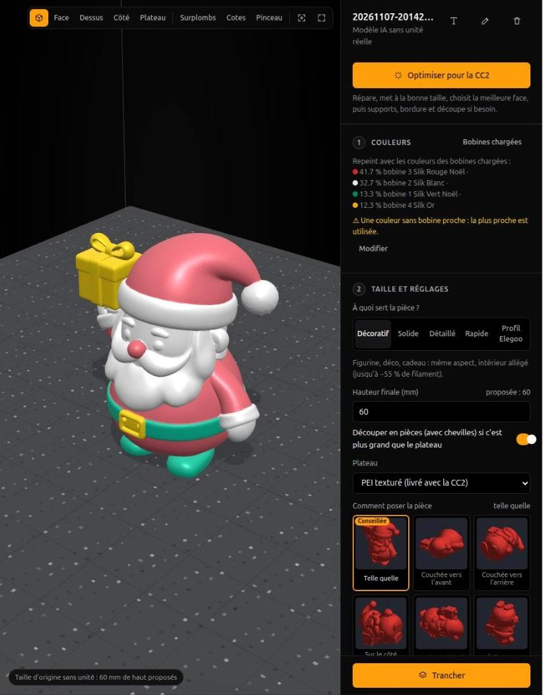
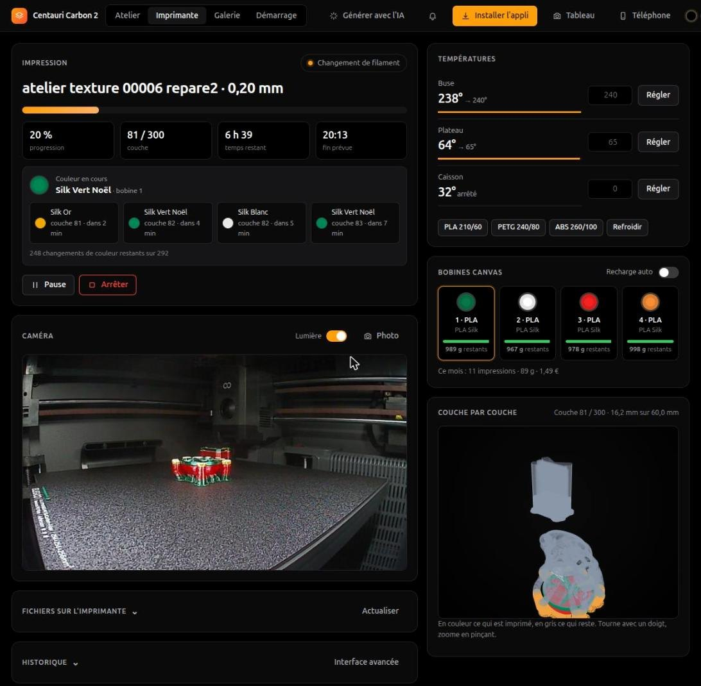
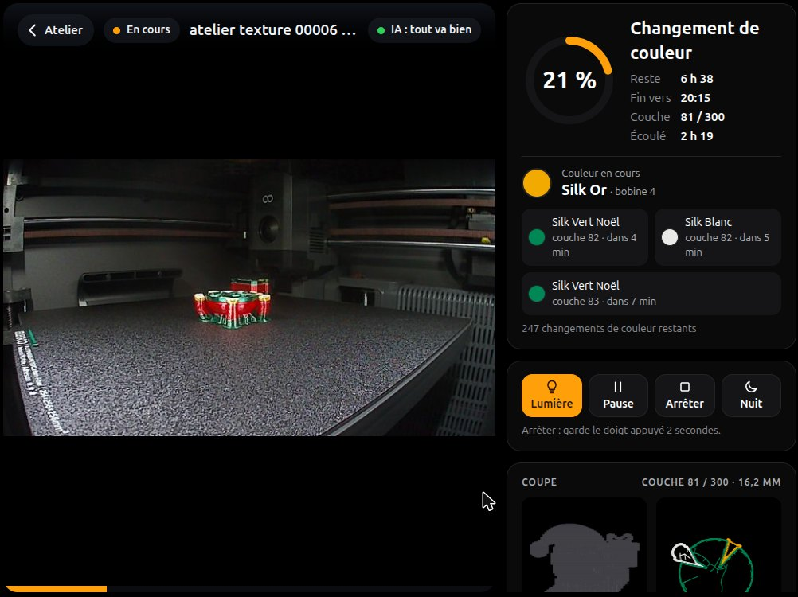

# Atelier CC2

🇬🇧 [English version](README.md)

Un atelier web open source pour l'**Elegoo Centauri Carbon 2** et son **CANVAS** (4 bobines). Il prépare un modèle 3D
en plusieurs couleurs, le tranche avec OrcaSlicer, l'envoie à l'imprimante, puis suit l'impression couche par couche :
caméra avec une IA anti-ratés, couleur en cours et à venir, alertes sur le téléphone, tableau de bord pour une
tablette, galerie avec bilan. Il tourne chez toi, sur un PC ou un petit serveur Linux, et s'ouvre depuis n'importe quel
appareil de la maison.

| Préparer | Suivre | Tablette murale |
|---|---|---|
|  |  |  |

*Captures pendant une vraie impression en quatre couleurs.* Présentation : https://jeanphi5507.github.io/atelier-cc2/

> **Projet personnel, non affilié à Elegoo.** « Elegoo », « Centauri Carbon » et « CANVAS » sont des marques d'Elegoo.
> Le protocole réseau de l'imprimante n'est pas documenté : l'atelier passe par
> [pycentauri](https://github.com/bjan/pycentauri), issu de la rétro-ingénierie. Une mise à jour du firmware peut
> casser une commande. Testé sur une CC2 avec CANVAS, firmware 02.01.01.13.

## Ce qu'il fait

- **Préparer** : importer un STL, 3MF, OBJ, GLB, PLY ou un lien vers un fichier (ou une page qui en propose un) ; associer chaque couleur à
  une bobine du CANVAS ; « Optimiser pour la CC2 » (réparation, taille, meilleure face au plateau, supports, bordure) ;
  découper une pièce trop grande avec des chevilles ; créer des pièces sans CAO (Gridfinity, visserie, engrenage,
  porte-clés et décoration au prénom, lithophanie…).
- **Trancher** : OrcaSlicer en ligne de commande, avec les profils Elegoo de la CC2. Temps, grammes, coût et nombre
  de changements de couleur avant de lancer, comparaison de variantes, purge dosée, modes multicolores.
- **Imprimer** : envoi à la CC2 avec la bonne bobine pour chaque couleur, vérification à la caméra que le plateau est
  vide, file d'attente, pause à une hauteur donnée.
- **Suivre** : caméra en direct, IA qui repère les « spaghettis » (modèle d'Obico, calculé chez toi), la pièce qui
  monte en 3D, vue en coupe, couleur en cours et prochains changements, timelapse.
- **Être prévenu** : fin d'impression, plus de filament, erreur, puis « plateau froid : tu peux retirer la pièce »,
  sur la page ouverte ou sur le téléphone même appli fermée (ntfy).
- **Garder une trace** : galerie de chaque impression (photo, vidéo, durée, coût), bilan des défauts avec la correction
  proposée la fois suivante, stock et coût des bobines, carnet d'entretien.
- **Générer par IA** (facultatif) : une photo ou une phrase devient un modèle 3D en couleurs, via un
  [ComfyUI](https://github.com/comfyanonymous/ComfyUI) sur une machine avec carte graphique.

## Démarrage rapide

Il faut un **Linux x86-64** (PC, mini-PC ou serveur), **Python 3.12** et [uv](https://docs.astral.sh/uv/).

```bash
git clone https://github.com/JEANPHI5507/atelier-cc2 && cd atelier-cc2
uv sync                       # dépendances Python
make slicer                   # OrcaSlicer 2.4.2 (≈ 138 Mo, empreinte vérifiée) et le plateau de la CC2
make ia                       # facultatif : le modèle anti-ratés d'Obico (≈ 200 Mo)
```

**Sans imprimante**, pour essayer :

```bash
uv run cc2 simulateur         # puis http://localhost:8788/lab/
```

Une CC2 simulée démarre avec l'atelier : caméra dessinée, CANVAS de quatre bobines, impressions en accéléré. Tout se
passe dans `demo/` : rien d'autre n'est touché.

**Avec ta CC2** : active le mode réseau local sur l'écran de l'imprimante, puis :

```bash
uv run cc2 --control dash     # http://localhost:8787/lab/ : l'onglet Démarrage demande l'IP et le code d'accès
```

Sans `--control`, l'atelier est en lecture seule : il ne peut ni lancer, ni arrêter, ni chauffer.

## Les guides

| Guide | Pour |
|---|---|
| [Installation](guide/installation.md) | PC ou serveur sans écran, démarrage automatique, mise à jour |
| [Première connexion à la CC2](guide/premiere-connexion.md) | mode LAN, code d'accès, pièces de test |
| [Téléphone, tablette, hors de la maison](guide/telephone-et-tablette.md) | HTTPS, appli installable, tablette murale, Tailscale |
| [Alertes](guide/alertes.md) | notifications, ntfy, plateau froid |
| [Préparer et imprimer](guide/preparer-et-imprimer.md) | couleurs et bobines, optimiser, multicolore, découpe, Créer, lancer |
| [Suivre une impression](guide/suivre.md) | caméra et IA, couches, couleurs, galerie, bilan, entretien |
| [Génération IA avec ComfyUI](guide/comfyui.md) | installer ComfyUI, modèles à télécharger, workflows |
| [Réglages (`config.toml`)](guide/configuration.md) | toutes les options |
| [Ligne de commande](guide/ligne-de-commande.md) | `cc2 status`, `cc2 slice`, `cc2 gen`… |
| [Ce qu'il faut savoir sur la CC2](guide/cc2.md) | firmware, CANVAS, purge, limites du réseau local |
| [Dépannage](guide/depannage.md) | les problèmes courants et quoi faire |
| [Développement](guide/developpement.md) | organisation du code, tests, simulateur |

## Limites

- Linux x86-64 seulement (OrcaSlicer y est fourni en AppImage). Pas de version Windows ou macOS pour l'instant.
- Une seule imprimante testée : une CC2 avec CANVAS. La Centauri Carbon (première du nom) n'a pas été essayée :
  l'atelier est pensé pour la CC2 et son CANVAS.
- Le réseau local de la CC2 refuse certaines commandes (mise en origine, déplacements, calibrations, chargement de
  filament) : elles restent sur l'écran de l'imprimante. L'atelier le dit quand c'est le cas.

## Licence

Code sous licence MIT (voir [`LICENSE`](LICENSE)). Fourni avec : three.js (MIT, `src/elegoo_lab/web/vendor`).
Téléchargés à l'installation, sous leurs propres licences : OrcaSlicer et le plateau Elegoo qu'il contient
(AGPL-3.0), pycentauri (Apache-2.0), le modèle de détection d'Obico (AGPL-3.0, `make ia`). Les workflows ComfyUI
utilisent des modèles aux licences variées : voir [le guide ComfyUI](guide/comfyui.md).
