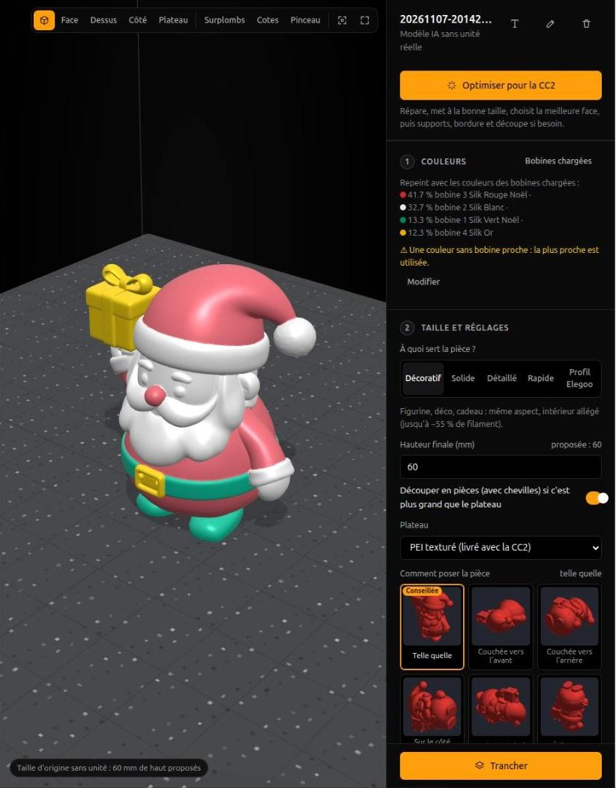
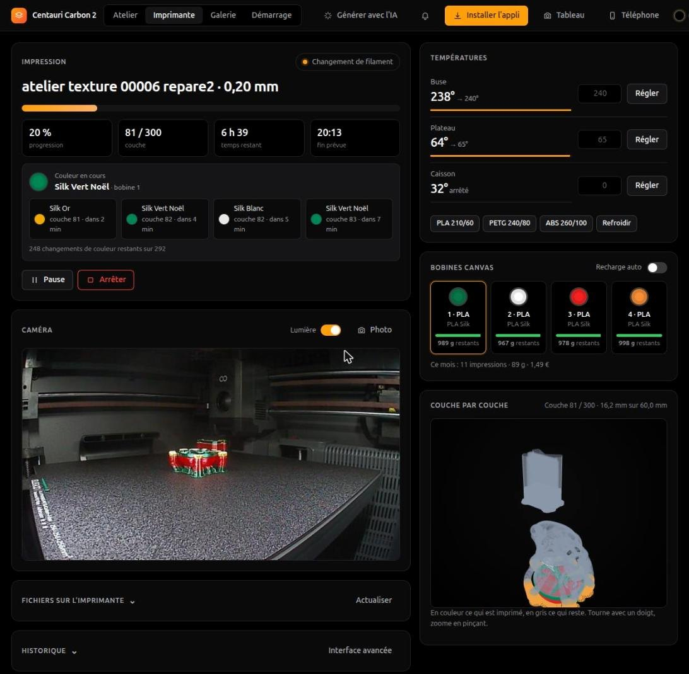
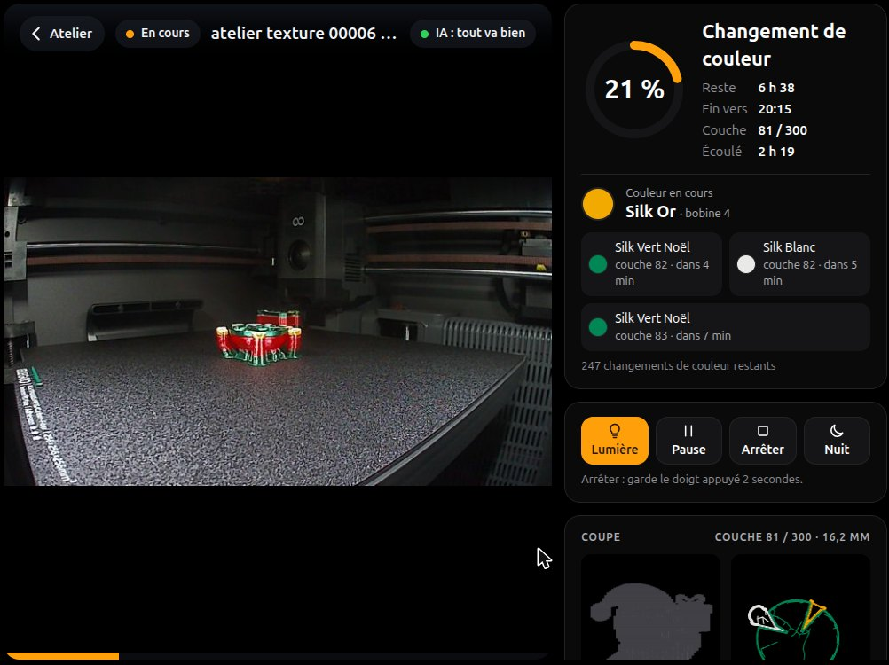

# Atelier CC2

🇫🇷 [Version française](README.fr.md) · **The interface is in French for now** (the documentation is in English and French).

An open-source web workshop for the **Elegoo Centauri Carbon 2** and its **CANVAS** (4 spools). It prepares a
multicolour 3D model, slices it with OrcaSlicer, sends it to the printer, then follows the print layer by layer: camera
with failed-print detection, current and upcoming colour, phone alerts, a wall-tablet dashboard, a gallery with a
post-print review. It runs at home, on a Linux PC or small server, and opens from any device on your network.

| Prepare | Monitor | Wall tablet |
|---|---|---|
|  |  |  |

*Screenshots taken during a real four-colour print.* Overview: https://jeanphi5507.github.io/atelier-cc2/en.html

> **Personal project, not affiliated with Elegoo.** "Elegoo", "Centauri Carbon" and "CANVAS" are trademarks of Elegoo.
> The printer's network protocol is undocumented: the workshop goes through
> [pycentauri](https://github.com/bjan/pycentauri), which comes from reverse engineering. A firmware update may break a
> command. Tested on a CC2 with CANVAS, firmware 02.01.01.13.

## What it does

- **Prepare**: import an STL, 3MF, OBJ, GLB, PLY or a link to a file (or to a page that offers one); map each colour to
  a CANVAS spool; "Optimise for the CC2" (repair, size, best face on the plate, supports, brim); cut an oversized part
  into pieces with dowels; create parts without CAD (Gridfinity, screws and nuts, gears, name keychains and Christmas
  ornaments, lithophanes…).
- **Slice**: OrcaSlicer from the command line, with Elegoo's CC2 profiles. Time, grams, cost and number of colour
  changes before starting, side-by-side comparison of variants, purge sized per colour change, multicolour modes.
- **Print**: sent to the CC2 with the right spool for each colour, a camera check that the plate is empty, a print
  queue, pause at a given height.
- **Monitor**: live camera, an AI that spots "spaghetti" (Obico's model, run on your own machine), the part growing in
  3D, a cross-section view, current colour and upcoming changes, timelapse.
- **Get notified**: print finished, out of filament, error, then "plate cold: you can take the part off", on the open
  page or on your phone even with the app closed (ntfy).
- **Keep track**: a gallery of every print (photo, video, duration, cost), a review of defects with the fix offered next
  time, spool stock and cost, a maintenance log.
- **Generate with AI** (optional): a photo or a sentence becomes a coloured 3D model, through a
  [ComfyUI](https://github.com/comfyanonymous/ComfyUI) running on a machine with a graphics card.

## Quick start

You need **Linux x86-64** (PC, mini-PC or server), **Python 3.12** and [uv](https://docs.astral.sh/uv/).

```bash
git clone https://github.com/JEANPHI5507/atelier-cc2 && cd atelier-cc2
uv sync                       # Python dependencies
make slicer                   # OrcaSlicer 2.4.2 (≈ 138 MB, checksum verified) and the CC2 build plate
make ia                       # optional: Obico's failed-print detection model (≈ 200 MB)
```

**Without a printer**, to try it out:

```bash
uv run cc2 simulateur         # then http://localhost:8788/lab/
```

A simulated CC2 starts with the workshop: drawn camera, a CANVAS with four spools, prints in fast motion. Everything
happens in `demo/`: nothing else is touched.

**With your CC2**: enable local network mode on the printer's screen, then:

```bash
uv run cc2 --control dash     # http://localhost:8787/lab/ : the "Démarrage" (setup) tab asks for the IP and access code
```

Without `--control`, the workshop is read-only: it can't start, stop or heat anything.

## Guides

| Guide | For |
|---|---|
| [Installation](guide/en/installation.md) | PC or headless server, automatic start, updates |
| [First connection to the CC2](guide/en/first-connection.md) | LAN mode, access code, test prints |
| [Phone, tablet, away from home](guide/en/phone-and-tablet.md) | HTTPS, installable app, wall tablet, Tailscale |
| [Alerts](guide/en/alerts.md) | notifications, ntfy, plate cold |
| [Prepare and print](guide/en/prepare-and-print.md) | colours and spools, optimise, multicolour, cutting, Create, starting a print |
| [Monitor a print](guide/en/monitoring.md) | camera and AI, layers, colours, gallery, review, maintenance |
| [AI generation with ComfyUI](guide/en/comfyui.md) | installing ComfyUI, models to download, workflows |
| [Settings (`config.toml`)](guide/en/configuration.md) | every option |
| [Command line](guide/en/command-line.md) | `cc2 status`, `cc2 slice`, `cc2 gen`… |
| [What to know about the CC2](guide/en/cc2.md) | firmware, CANVAS, purge, local network limits |
| [Troubleshooting](guide/en/troubleshooting.md) | common problems and what to do |
| [Development](guide/en/development.md) | code layout, tests, simulator |

The interface uses French labels; the guides give each label in French with its meaning, so you can find your way.

## Limits

- Linux x86-64 only (OrcaSlicer ships there as an AppImage). No Windows or macOS version for now.
- One printer tested: a CC2 with CANVAS. The original Centauri Carbon hasn't been tried: the workshop is designed for
  the CC2 and its CANVAS.
- The CC2's local network refuses some commands (homing, moves, calibrations, filament loading): they stay on the
  printer's screen. The workshop says so when it happens.
- The interface is in French only for now.

## Licence

Code under the MIT licence (see [`LICENSE`](LICENSE)). Bundled: three.js (MIT, `src/elegoo_lab/web/vendor`).
Downloaded at install time, under their own licences: OrcaSlicer and the Elegoo build plate it contains (AGPL-3.0),
pycentauri (Apache-2.0), Obico's detection model (AGPL-3.0, `make ia`). The ComfyUI workflows use models with various
licences: see [the ComfyUI guide](guide/en/comfyui.md).
