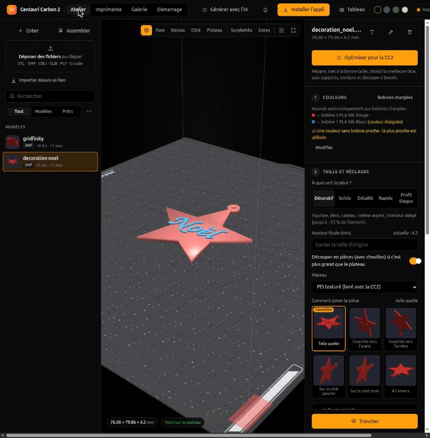
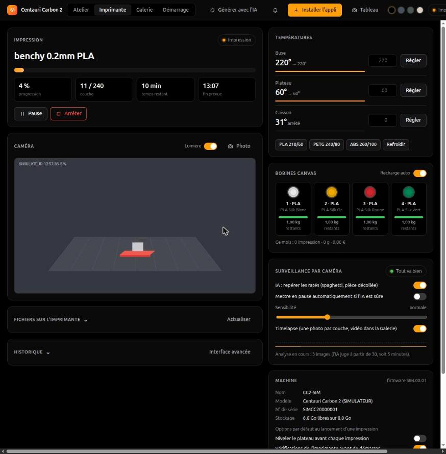

# Atelier Elegoo Centauri Carbon 2

Un atelier web pour la Centauri Carbon 2 et son CANVAS (4 bobines) : préparer un modèle 3D (couleurs → bobines,
taille, orientation, découpe, réparation), le trancher avec OrcaSlicer, le lancer, puis suivre l'impression
(caméra et IA anti-ratés, couches, couleur en cours et à venir, alertes sur le téléphone, tablette murale, galerie
avec bilan). Il tourne sur un PC ou un petit serveur de la maison ; on y accède depuis le téléphone (appli installable).

| Préparer | Suivre | Tablette murale |
|---|---|---|
|  |  |  |

*Captures prises avec `cc2 simulateur`.* · Présentation : https://jeanphi5507.github.io/atelier-cc2/

> **Projet personnel, non affilié à Elegoo.** « Elegoo », « Centauri Carbon » et « CANVAS » sont des marques
> d'Elegoo. Le protocole de l'imprimante n'est pas documenté : il passe par
> [pycentauri](https://github.com/bjan/pycentauri) (rétro-ingénierie). Utilisation à tes risques ; testé sur une vraie
> CC2 (firmware 02.01.01.13).

```
idée / photo ──► ComfyUI (machine GPU) ──► models/*.glb ─┐
fichier STL / 3MF / OBJ / GLB (MakerWorld, CAO…) ─────────┤
                                                          ▼
              Atelier : couleurs → bobines CANVAS, taille, orientation, découpe
                                                          │
                              OrcaSlicer intégré (profils CC2) → G-code
                                                          │
                         Onglet Imprimante / cc2 ──► Centauri Carbon 2
```

## Démarrage

Linux x86-64, Python 3.12 et [uv](https://docs.astral.sh/uv/).

```bash
uv sync                            # les dépendances Python
make slicer                        # OrcaSlicer 2.4.2 (≈138 Mo, empreinte vérifiée) et le plateau de la CC2
make ia                            # facultatif : le modèle de détection des ratés (Obico, 200 Mo)
cp config.example.toml config.toml # adresse IP et code d'accès de l'imprimante (ou l'onglet Démarrage)
uv run cc2 --control dash          # http://localhost:8787 (sans --control : lecture seule)
uv run cc2 status                  # ou n'importe quelle commande
```

Sur un serveur sans écran, OrcaSlicer demande quelques bibliothèques graphiques (GTK, OpenGL, WebKit) même pour
trancher : sous Ubuntu, `libopengl0 libglu1-mesa libgtk-3-0t64 libwebkit2gtk-4.1-0` et leurs voisines.

`uv run cc2 --help` liste tout. Raccourci : `source .venv/bin/activate` puis `cc2 ...`.

## Essayer sans imprimante

```bash
uv run cc2 simulateur              # http://localhost:8788/lab/
```

Une Centauri Carbon 2 simulée démarre avec l'atelier : caméra dessinée, CANVAS de quatre bobines PLA Silk, fichiers sur
l'imprimante et impressions en accéléré (`--duree 120` = deux minutes par impression). Tout se passe dans `demo/`
(bibliothèque et réglages à part) : la vraie bibliothèque et `config.toml` ne sont pas touchés, et le simulateur peut
tourner à côté de l'atelier réel (port 8788 au lieu de 8787). C'est un modèle simplifié du protocole, pas du firmware :
les tests l'utilisent aussi.

## Quand l'imprimante arrive

Tout est guidé dans l'onglet **Démarrage** de l'atelier :

1. **Connexion** : active « LAN Only » sur l'écran (Paramètres → Réseau), saisis l'IP et le code d'accès,
   « Tester la connexion » vérifie réseau → code et mode LAN → imprimante, et explique quoi corriger à chaque
   échec. « Enregistrer » écrit `config.toml`, puis relance l'atelier en réel : `uv run cc2 --control dash`.
2. **CANVAS** : 4 bobines de PLA de couleurs bien différentes.
3. **Pièces de test**, générées et tranchées à la demande, avec ce qu'il faut vérifier (cases à cocher) :
   première couche (5 carrés, 3 min), cube 20 mm (14 min), CANVAS 4 couleurs en mode Économie (42 min),
   ajustement des chevilles (43 min).
4. **Jeu des chevilles** : choisi d'après le test, enregistré dans `[assemblage] jeu_mm` et utilisé par toutes
   les découpes suivantes (0,15 mm par défaut).

En ligne de commande : `uv run cc2 doctor`, puis `uv run cc2 status` (lecture seule).
Les commandes qui **modifient** l'imprimante exigent `--control`.

## Onglet Imprimante

Suivi et pilotage en direct, dans le même thème que l'atelier : état, progression, couche, temps restant et
heure de fin ; pause / reprise / arrêt ; caméra ; températures (buse, plateau, caisson) avec préréglages PLA /
PETG / ABS ; les 4 bobines du CANVAS et la recharge automatique ; vitesse, ventilateurs, lumière ; fichiers
présents sur l'imprimante (lancer, supprimer) et historique. Tout ce qui agit sur l'imprimante demande
`--control` et une confirmation pour lancer ou arrêter. L'ancienne interface de pycentauri reste accessible
via « Interface avancée ».

## Depuis le téléphone (appli)

```bash
uv run cc2 --control dash --reseau
```

L'atelier s'ouvre au Wi-Fi de la maison, en **HTTPS** sur le port 8443, et s'installe comme une **appli** :
icône sur l'écran d'accueil, plein écran, et un message clair si le PC est éteint.

Sur le PC, le bouton **Téléphone** guide pas à pas (Android ou iPhone) :
1. **Certificat de l'atelier (une seule fois)** : un QR code télécharge `atelier-cc2.crt`, à installer dans les
   réglages du téléphone. C'est lui qui permet le HTTPS sans alerte (autorité créée sur ce PC, dans `.certs/`,
   clé privée lisible par toi seul ; le certificat du serveur se renouvelle tout seul, même si l'adresse change).
2. **Ouvrir et installer** : un second QR code ouvre l'atelier. Saisis le code d'accès, puis bouton
   **Installer l'appli** (Android) ou **Partager → Sur l'écran d'accueil** (iPhone).

**Code d'accès** : 6 chiffres affichés une seule fois au premier lancement (enregistrés seulement chiffrés).
Le téléphone le demande une fois puis reste connecté 30 jours ; 5 erreurs = 5 minutes d'attente ; ce PC n'en a
jamais besoin. `uv run cc2 code-acces` le change et déconnecte les téléphones.
Depuis le réseau, l'ancienne adresse HTTP (`:8787`) ne sert plus qu'à donner le certificat et renvoie vers HTTPS.
`--sans-https` garde l'ancien fonctionnement (pas d'installation en appli). Sans `--reseau`, rien n'est visible
depuis le réseau.

## Démarrage automatique

```bash
uv run cc2 --control service installer
```

L'atelier devient un service : il démarre avec le PC (même sans session ouverte) et se relance tout seul en cas
d'arrêt. `cc2 service etat`, `cc2 service journal`, `cc2 service retirer`. Ne lance plus `cc2 dash` à la main en
même temps (ports déjà pris).

## Bibliothèque et fichiers prêts à imprimer

- **Vues** : Tout, Modèles, **Prêts** (les G-code rangés sous le modèle dont ils viennent). Tri par date, nom
  ou taille (menu « ⋯ »). Recherche aussi sur le nom du modèle d'origine.
- **Vignettes** : l'image intégrée au G-code (celle de l'écran de la CC2), un rendu pour les modèles.
- **Fiche de chaque G-code** : modèle d'origine, qualité, usage, durée, grammes, coût, pastilles des couleurs,
  badge **« sur la CC2 »** s'il est déjà sur l'imprimante. Chaque modèle indique combien de G-code prêts il a.
- **Renommer** (crayon à côté de la corbeille) : l'extension est gardée, aucun fichier n'est écrasé, et les
  G-code restent reliés à leur modèle (et leur consommation de bobines connue).
- **Sélectionner plusieurs fichiers** et les supprimer d'un coup (menu « ⋯ »).
- **Faire le ménage** (menu « ⋯ ») : propose les fichiers techniques (conversions couleur, pièces découpées)
  et les G-code dont le modèle a été supprimé, avec la place gagnée ; tu décoches ce que tu gardes.
- Les **fichiers techniques** sont masqués par défaut (case dans le menu « ⋯ » pour les voir).
- Données : `models/.index.json` (fiche des G-code), `models/.thumbs/` (vignettes des modèles).

## Visualiseur 3D

Barre d'outils en haut à droite de la vue :
- **Vues** 3D, Face, Dessus, Côté, **Recentrer** et **Plein écran** (pratique sur tablette).
- **Surplombs** : colore en rouge, en direct, les zones penchées à plus de 50° qui auront besoin de supports
  (la vue passe en contre-plongée, puisqu'elles regardent vers le bas) ; suit chaque changement de position.
- **Cotes** : boîte englobante et dimensions à la taille d'impression (L × P × H).
- Le plateau montre le **coin interdit** de la CC2 (avant droit, 10 × 20 mm).

En **tranchage** : ▶ joue l'impression couche par couche (environ 10 s pour tout), **Couche seule** montre
une seule couche vue de dessus (trajets de parois, remplissage, supports), − / + avancent d'une couche.

## Comment poser la pièce

À l'étape 2, six vignettes montrent la pièce **telle quelle, couchée vers l'avant ou l'arrière, sur le côté
gauche ou droit, ou à l'envers** ; un clic la pose ainsi (aperçu 3D, taille et tranchage suivent), et
« ↻ Tourner sur le plateau » la fait pivoter à plat. L'atelier marque la position **conseillée** : le moins de
surplombs (mesurés couche par couche, comme le conseiller), une vraie surface au sol (une pièce posée sur
quelques mm² se décolle), et à égalité la moins haute. Une position qui ne tient pas sur le plateau est grisée.

## Bonne qualité, moins de filament

Mesuré sur le profil CC2 (OrcaSlicer) — c'est ce qui guide les choix par défaut :

| Pièce | Réglage | Filament | Temps |
|---|---|---|---|
| Figurine 95 mm, 1 couleur | profil Elegoo (15 % lignes) | 62 g | 3 h 35 |
| | **Décoratif** (remplissage « éclair » 8 %) | **26 g** | **2 h 13** |
| Perroquet 60 mm, 4 couleurs | Décoratif, 0,20 mm | 51 g (dont **36 g de purge**) | 8 h 33 |
| | Rapide, 0,24 mm | 45 g | 7 h 05 |
| | 2 exemplaires ensemble | 33 g par pièce | 5 h 22 par pièce |
| | **4 exemplaires ensemble** | **24 g par pièce** | **3 h 44 par pièce** |

- **À quoi sert la pièce ?** (étape 2) : *Décoratif* (défaut : même aspect, intérieur allégé), *Solide*
  (4 parois, gyroïde ; proposé d'office pour les boîtes, crochets, organiseurs), *Détaillé* (0,12 mm),
  *Rapide* (0,24 mm), *Profil Elegoo* (rien de changé). Les réglages avancés gardent le dernier mot.
- **Comparer les options** (étape 3) : tranche chaque variante en arrière-plan (≈ 10 s chacune) et montre
  filament, coût et temps, en écart avec ton choix ; « Choisir » l'applique.
- En multicolore, la **purge pèse plus que la pièce** (36 g pour 16 g ci-dessus). Elle se fait dans la goulotte
  de la CC2, et le firmware pousse **toujours au moins 23 mm de filament par changement, plus 6 mm** (lu dans
  son code source, `M6211`), même si le slicer en demande moins : réduire encore la matrice de purge ne sert
  donc à rien, et OrcaSlicer sous-estime la purge (l'atelier la recompte comme le firmware). Les vrais leviers :
  moins de changements (couches de 0,24 mm) et surtout **plusieurs pièces par plateau**, car les changements de
  couleur se font couche par couche pour toutes les pièces à la fois : la purge est partagée.
- Avec plusieurs exemplaires, le G-code marque chaque pièce (`EXCLUDE_OBJECT_DEFINE`, que le firmware lit comme
  Klipper) : si l'une rate, on peut l'abandonner et terminer les autres.

## Lancer une impression (réglages machine)

Chaque lancement passe par une fenêtre qui envoie à la CC2 ses **vraies options de départ** (pycentauri n'en
envoie aucune) :
- **Quelle bobine pour chaque couleur** (`slot_map`) : proposée d'après les couleurs du G-code et les bobines
  du CANVAS (même position si la couleur correspond, sinon la plus proche), modifiable. Sans elle, le firmware
  garde sa table par défaut : T0 → canal 0 … T3 → canal 3 (juste si les couleurs du fichier sont dans l'ordre
  des bobines, faux sinon).
- **Niveler le plateau avant**, **vérifications de l'imprimante**, **timelapse de l'imprimante**,
  **disposition A/B** ; à garder par défaut si tu veux (carte **Machine** de l'onglet Imprimante, qui montre
  aussi le nom, le modèle, le firmware et le stockage libre).
- Grammes et coût, avec l'alerte si une bobine ne suffira pas.

**Limites du réseau local** (SDK officiel d'Elegoo) : mise en origine, déplacements, décalage Z, calibrations et
chargement de filament se font sur l'écran de la CC2 ; la reprise et la consigne de température peuvent aussi
être refusées en réseau. L'atelier le dit et indique quoi faire sur l'écran.

## Conseiller avant impression

Dans l'étape **Trancher**, le conseiller regarde le modèle tel qu'il sera imprimé (taille, orientation, supports)
et prévient avant de perdre une bobine : **parois trop fines** (< 0,8 mm, deux passages de buse), **peu de
contact avec le plateau** (décollement), **surplombs sans support** (mesurés couche par couche, comme le
slicer), **morceau en l'air**, pièce haute et fine, maillage ouvert, plus grand que le plateau. Chaque point a
un bouton qui applique la correction (supports en arbre, bordure, agrandir, découper), puis il revérifie.
**Maillage ouvert** : « Réparer automatiquement » crée une copie `nom_repare.glb` fermée (sommets soudés, faces
douteuses et éclats retirés, trous rebouchés, couleurs gardées) ; l'original n'est jamais touché. Si le maillage est trop
abîmé pour être fermé sans le refaire, la réparation refuse et conseille de régénérer le modèle.

## Bobines et coûts

Chaque bobine du CANVAS a son **stock** (onglet Imprimante, cliquer une bobine pour corriger le poids, le
poids d'une bobine pleine et le prix au kilo ; 20 €/kg et 1 kg par défaut).
- Au tranchage : grammes et **coût** de la pièce (purge du CANVAS comprise), par bobine.
- Avant de lancer : alerte si une bobine ne suffira pas.
- À la fin (ou à l'arrêt, au prorata) : le filament est retiré des bobines ; alerte « bobine presque vide »
  sous 100 g. Une nouvelle bobine détectée dans le CANVAS (autre puce, couleur ou matière) repart pleine.
- Total du mois sous les bobines. Données dans `models/.bobines.json`.

## Surveillance par caméra (IA) et timelapse

Pendant l'impression, l'atelier regarde la caméra :
- **IA anti-ratés** : une image toutes les 10 s passe dans le modèle libre d'Obico (The Spaghetti Detective,
  AGPL-3.0), **sur ce PC** (≈ 0,15 s par image, aucune image ne sort de la maison). Le score suit l'algorithme
  publié par Obico : il compare à la propre « normale » de l'impression et attend 30 images (5 min) avant de
  juger. Doute → alerte « Impression suspecte » avec la photo encadrée ; certitude → **pause automatique**
  (à activer) puis alerte. Après ta reprise, l'IA repart de zéro.
- **Timelapse** : une photo à chaque nouvelle couche, assemblée en vidéo MP4 à la fin (ffmpeg).
- Réglages dans l'onglet Imprimante (carte « Surveillance par caméra ») : IA, pause automatique, sensibilité,
  timelapse. Le modèle (200 Mo, empreinte vérifiée) s'installe d'un clic ou avec `make ia`.

## Galerie

Onglet **Galerie** : chaque impression avec sa vidéo en accéléré, sa photo, sa durée, ses grammes et son coût,
son issue (terminée, arrêtée, erreur) et les alertes de l'IA avec leurs photos. **Réimprimer** relance le même
G-code (avec la vérification des bobines). Données dans `models/.galerie/` (200 dernières impressions).

## Tableau de bord sur une tablette

Une vieille tablette devient l'écran de l'imprimante : `https://<IP du PC>:8443/lab/tableau.html` (bouton
**Tableau** dans l'atelier ; même code d'accès et même certificat que le téléphone, et elle s'installe aussi en appli).
- **Caméra en direct** en grand, nom du fichier, barre de progression et état de l'IA par-dessus.
- **Impression** : pourcentage, temps restant, heure de fin, couche, temps écoulé.
- **Températures**, **bobines** du CANVAS (celle en cours entourée, grammes restants), **alertes** en direct
  avec un son (et un grand message en haut de l'écran).
- **Au repos** : dernière impression (photo, durée, coût), total du mois, entretien à faire.
- **Commandes** : lumière, pause / reprise, **arrêt en gardant le doigt 2 s** (pas d'arrêt par erreur).
- **Écran allumé** (verrou d'écran du navigateur, en HTTPS), **plein écran**, **mode nuit** (atténué de 22 h à 7 h
  quand rien n'imprime, ou à la main ; une alerte grave le rallume).
- Pensé pour les navigateurs anciens (pas de syntaxe récente), en paysage comme en portrait.

Conseil : tablette sur secteur, et dans ses réglages « ne jamais éteindre l'écran pendant la charge ».

**Tablette ChromeOS** (onglet ChromeOS du guide Téléphone, sur le PC) : ouvre `http://<IP du PC>:8787/lab/ca.crt`
dans Chrome, puis **Paramètres → Confidentialité et sécurité → Sécurité → Gérer les certificats → Autorités →
Importer** (ou `chrome://certificate-manager`) et coche « Faire confiance à ce certificat pour identifier des sites
Web ». Ouvre ensuite le tableau et installe-le (icône dans la barre d'adresse ou **⋮ → Installer**) ; dans
**Paramètres → Appareil → Alimentation**, garde l'écran allumé en charge.

Les fichiers de l'interface sont revérifiés à chaque ouverture : après une mise à jour de l'atelier, la tablette et
le téléphone affichent tout de suite la nouvelle version.

## Suivi et alertes

L'atelier surveille l'imprimante **même sans page ouverte** et note chaque étape dans le journal (cloche en haut) :
début, pause, **plus de filament**, reprise, **fin** (avec une photo de la caméra, gardée dans `models/.photos/`),
arrêt, erreur, imprimante injoignable. Sur une page ouverte : message, son et vibration (désactivables) ;
sur ce PC, notification du système si tu l'autorises.

Pour être prévenu **hors de la maison**, option ntfy (opt-in, le message passe alors par Internet) : installe
l'appli ntfy, abonne-toi à un sujet difficile à deviner, puis dans `config.toml` :

```toml
[alertes]
ntfy = "https://ntfy.sh/mon-sujet-secret-cc2"
```

## Génération IA avec ComfyUI

ComfyUI tourne sur la machine GPU (RTX 5060 Ti 16 Go), joignable ici sur `http://127.0.0.1:8188`
(transfert de port VS Code). Workflows prêts dans `workflows/`, visibles dans « Générer avec l'IA » :

| Workflow | Entrée | Modèles | Sortie |
|---|---|---|---|
| `photo_vers_figurine_3d` | une photo (personnes, animal, objet) | Qwen Image Edit 2511 → TRELLIS.2 | figurine en pied sur socle, GLB en couleurs + l'image de la figurine |
| `photo_vers_figurine` | une photo | Qwen Image Edit 2511 (4 étapes, ≈ 40 s) | seulement l'image de la figurine, pour essayer |
| `trellis_image_vers_3d` | une image (objet seul) | TRELLIS.2 (MIT) | GLB texturé + GLB peint aux couleurs |
| `trellis_texte_vers_3d` | une description | Z-Image Turbo → TRELLIS.2 | idem, plus l'image de référence |
| `hunyuan_image_vers_3d`, `hunyuan_texte_vers_3d` | image / texte | Hunyuan3D 2.1 (licence hors UE) | forme seule |

```bash
cc2 gen trellis_texte_vers_3d --prompt "un petit dragon"
cc2 gen trellis_image_vers_3d --image photo.png
```

Une photo brute (selfie, fond chargé, personnes coupées) donne un mauvais 3D : `photo_vers_figurine_3d` la fait d'abord
redessiner en figurine propre (toutes les personnes en pied, socle commun, couleurs franches, fond uni) ; l'image
intermédiaire est gardée dans `models/references/` et affichée dans la fenêtre de génération.

Les GLB arrivent dans la bibliothèque ; leurs couleurs sont détectées et converties en 4 bobines CANVAS au
tranchage (`cc2 slice fichier.glb --height 60`).

**Licence** : Hunyuan3D 2.1 est sous licence Tencent, qui ne s'applique pas dans l'UE, au Royaume-Uni ni en Corée
du Sud ; ses workflows sont gardés mais à ne pas utiliser en France. TRELLIS.2 est sous MIT ; il s'appuie sur
DINOv3 (licence Meta, à relire avant tout usage commercial).

Les workflows TRELLIS.2 ont été générés depuis le modèle officiel « Pixal3D & TRELLIS.2: Image to Model »
de ComfyUI (export API par l'interface de ComfyUI), interrupteur réglé sur TRELLIS.2, branche Pixal3D retirée,
texture 2048 px et 300 000 faces. Ajouter un workflow : l'exporter en « API » dans ComfyUI, le poser dans
`workflows/NOM.json` et décrire ses entrées dans `workflows/NOM.map.json` (`image`, `prompt`, `seed`).

## De l'idée à l'impression

1. `cc2 models prepare models/xxx.glb --height 60` : STL réparé, posé sur le plateau, à 60 mm de haut.
   `cc2 models info` indique si le maillage est étanche et s'il tient dans 256 mm.
2. Trancher : `cc2 slice models/xxx_print.stl` (ou bouton « Trancher » de l'atelier). Utilise
   OrcaSlicer en ligne de commande avec ses profils Elegoo Centauri Carbon 2 intégrés.
   Options : `--quality "0.16mm Optimal"`, `--filament PETG`, `--nozzle 0.6`, `--infill 15`, `--supports`.
   `cc2 slice-profiles` liste buses, qualités et filaments. L'imprimante n'imprime que du G-code / 3MF tranché.
3. Envoyer + lancer : `cc2 --control slice xxx.stl --upload --start`, ou onglet Atelier → « Envoyer ».
   (`--start` démarre l'impression : vérifie plateau et filament avant.)

Le slicer s'installe avec `make slicer` (OrcaSlicer 2.4.2, ≈138 Mo, empreinte SHA-256 vérifiée, dans `tools/`).
Pour utiliser ElegooSlicer à la place, renseigne `[slicer] path` dans `config.toml` (non testé).

### Multicolore (CANVAS, 4 bobines)

**Modèles déjà colorés** (le cas le plus courant) : 3MF multicolores (MakerWorld, Printables, OrcaSlicer,
Bambu Studio), GLB/GLTF, OBJ+MTL, PLY colorés. Les couleurs sont détectées automatiquement :

```bash
cc2 colors modele.3mf                       # couleurs trouvées et bobine proposée pour chacune
cc2 slice modele.3mf --filament PLA --filament "PLA Silk"     # T0, T1… dans l'ordre
cc2 slice modele.glb --slot 3:1 --height 80   # forcer la couleur 3 dans la bobine T0, 80 mm de haut
```

- Les 3MF peints gardent leur peinture exacte : seules les bobines sont renumérotées.
- Au-delà de 4 couleurs, les teintes proches sont regroupées (modifiable couleur par couleur).
- Les maillages colorés (GLB, PLY…) : une couleur par triangle, la précision dépend du maillage.

Dans l'onglet **Atelier**, c'est le même parcours : choisir le modèle → 1. Couleurs (bobine par couleur,
filament par bobine) → 2. Taille et réglages → 3. Trancher, puis « Imprimer maintenant ».

**Bobines réellement chargées** : quand l'imprimante répond, l'atelier lit le CANVAS (couleur et matière de chaque
bobine) et associe automatiquement chaque couleur du modèle à la bobine la plus proche à l'œil (écart ΔE en Lab,
affectation globale pour ne pas laisser une bobine libre pendant que deux couleurs se partagent la même). Le profil
filament suit la matière déclarée (« PLA Matte » → profil PLA Matte), le G-code porte les vraies couleurs, et une
alerte prévient si une couleur n'a pas de bobine proche ou si PLA et PETG sont mélangés. Bouton « Bobines
chargées » pour réappliquer ; tout reste modifiable à la main. Le test CANVAS du Démarrage garde volontairement
l'ordre fixe T0 → T3. Hypothèse à vérifier au premier test : le G-code T0..T3 correspond aux bobines 1 à 4 du CANVAS.

**Modèle livré en plusieurs fichiers** (une couleur par fichier) : bouton « Assembler » de la bibliothèque,
ou `cc2 multicolor socle.stl:1 dessus.stl:2 --filament PLA --filament "PLA Matte"`.

Fichiers réels testés : le badge multicolore livré avec OrcaSlicer (`OrcaBadge.3mf`, 3 objets, 39 pièces,
enregistré par une version plus récente) et les exemples colorés du consortium 3MF (`rhombicuboctahedron_color`,
`dodeca_chain_loop_color`, format couleur standard). Tous sont dans `models/`.

Chaque 3MF est relu puis **réécrit proprement** avant tranchage : OrcaSlicer 2.4.2 refuse ou plante sur certains
projets enregistrés par une version plus récente de Bambu Studio/Orca (cas du badge et de nombreux fichiers MakerWorld).

**Réglages du tranchage** (étape 2 de l'atelier, ou paramètres de `printprep.prepare_and_slice`) :
- **Plateau** : PEI texturé par défaut (celui livré avec la CC2 : plateau à 60 °C en PLA). Avant ce réglage, le
  slicer partait sur « Cool Plate » et ne chauffait le plateau qu'à 35 °C ; PEI lisse, froid et ingénierie au choix.
- **Orientation** : quarts de tour sur X, Y, Z (visibles dans l'aperçu et pris en compte pour la découpe), ou
  orientation automatique d'OrcaSlicer.
- **Exemplaires** : jusqu'à 50, disposés en grille (8 mm d'écart) ; refus clair s'ils ne tiennent pas.
- **Réglages avancés** (vide = valeur du profil CC2) : parois, couches pleines dessus/dessous, motif de remplissage
  (lignes, grille, gyroïde, nid d'abeille, cubique, éclair, triangles), couture, lissage du dessus, texture « peau »,
  bordure et sa largeur, radeau, angle des supports, température buse et plateau. Chaque valeur est vérifiée
  (plage, liste) avant d'aller au slicer, et chacun de ces réglages a été contrôlé dans le G-code produit.

**Supports** (`--supports`, ou « Supports » dans Taille et réglages) : `arbre` (organique, par défaut du profil CC2,
s'enlève facilement), `arbre_fin` (le plus léger), `arbre_solide`, `colonnes`, et `--plateau-seul` pour que rien ne
s'appuie sur le modèle. Sur le dragon de 60 mm : colonnes 2 h 01 / 5,2 m mais un bloc qui enferme l'avant du modèle,
arbre 2 h 09 / 5,4 m avec des branches qui ne touchent que les surplombs.

**Aperçu du tranchage** : après « Trancher » (ou en choisissant un G-code dans la bibliothèque), l'onglet
« Tranchage » de la vue 3D montre les trajets réels couche par couche, avec un curseur, les couleurs des bobines,
les supports en orange et la tour d'essuyage, chacun masquable.

**Pièces trop grandes** : si le modèle (à la hauteur choisie) dépasse le plateau, « Découper en pièces » (activé par
défaut dans l'atelier, `--decouper` en CLI) le coupe en tronçons de 246 mm maximum, aux endroits les plus fins
(section mesurée tous les 2 mm : cou, taille, attache de la queue) en évitant de trancher des pointes isolées ;
« voir la découpe » montre les pièces en vue éclatée avant de trancher. La découpe perce des trous de chevilles
Ø 5 mm de part et d'autre de chaque coupe et produit un G-code par pièce, plus un pour les chevilles (à imprimer à
100 %). Les couleurs sont conservées ; un morceau qui ne tiendrait que sur une pointe est posé sur sa face plane.
Exemple : dragon à 300 mm → coupes Y = 165 mm et Z = 150 mm, 4 pièces + 3 chevilles, 33 h 20, ≈ 700 g.

```bash
cc2 slice dragon_couleurs.glb --height 300 --decouper --supports arbre
```

**Économiser** (`--mode`, ou « Multicolore » dans Taille et réglages) — mesuré sur le perroquet de 60 mm, 4 couleurs :

| Mode | Durée | Filament réel (purge comprise) |
|---|---|---|
| `qualite` (réglages d'origine d'OrcaSlicer) | 13 h 13 | 67 m ≈ 200 g |
| `equilibre` (purge selon les couleurs) | 13 h 13 | 60 m ≈ 180 g |
| `economie` (par défaut : sans tour d'essuyage + purge selon les couleurs) | 8 h 26 | 12,5 m ≈ 38 g |
| `economie` + couches 0,28 mm + noir regroupé avec le bleu (3 couleurs) | 5 h 14 | 9,8 m ≈ 29 g |

La tour d'essuyage représentait ~90 % du filament : la CC2 purge déjà à chaque changement dans la goulotte
du CANVAS (macro `M6211`). Cette purge n'est pas comptée par OrcaSlicer ; l'atelier l'ajoute au total.
Le temps vient surtout des changements de bobine (~1 min chacun) : couches plus épaisses et moins de couleurs.
Le mode Économie n'a pas encore été imprimé : surveille les premiers changements (bavures possibles).

Limites : filaments aux températures incompatibles refusés (PLA + PETG), tour d'essuyage de 35 mm et purge
à chaque changement de couleur. Un modèle où chaque face a sa couleur multiplie les changements (320 pour le
rhombicuboctaèdre à 40 mm, plus de 10 h) : le résultat l'affiche et prévient au-delà de 150.
**Jamais imprimé en vrai**, et pas encore testé sur un fichier téléchargé depuis MakerWorld.

## Organisation

```
src/elegoo_lab/   access.py + certs.py (téléphone, HTTPS) · advisor.py (conseiller) · stock.py (bobines) · vision.py (IA caméra) · gallery.py (timelapse, galerie) · launch.py (lancement) · errors.py (codes CC2) · maintenance.py (entretien) · orient.py (positions) · library.py (bibliothèque) · alerts.py (suivi) · parametric.py (pièces sur mesure) · colors.py (détection/conversion couleurs) · printprep.py · colorize.py (assemblage) · cli.py (cc2) · app.py + web/ (tableau de bord) · comfy.py · mesh.py · slicer.py · config.py
web/              index.html (structure) · css/app.css · js/ : core (outils communs) · lab (atelier, 3D, tranchage)
                  · printer (onglet Imprimante) · setup (Démarrage) · gallery · alerts · app (onglets, démarrage) ; tableau.html + js/tableau.js (tablette)
tools/            OrcaSlicer (make slicer)
models/           tes modèles (STL, GLB, 3MF, G-code)
workflows/        workflows ComfyUI (format API) + leur .map.json
tests/            uv run pytest : test_core.py (serveur) et test_ui.py (un vrai Chrome clique dans un atelier de
                  test, avec une fausse imprimante (tests/fakeprinter.py), sa bibliothèque et ses ports à part ; ignoré sans Chrome)
config.toml       ta config (ignorée par git)
```

## Sécurité et garde-fous

- **Actions venant d'autres sites refusées** : toute requête qui modifie quelque chose (envoi, lancement, pause,
  arrêt, réglages, suppression) est rejetée si le navigateur indique qu'elle vient d'une autre page que l'atelier.
  Sans ça, n'importe quel site ouvert pouvait piloter l'imprimante. Le CLI et les scripts locaux ne sont pas concernés.
- L'atelier n'écoute que ce PC (`127.0.0.1`), sauf avec `--reseau` : les autres appareils passent alors en HTTPS
  et doivent saisir le code d'accès (stocké chiffré, essais limités, session en cookie protégé). `config.toml` est lisible par toi seul.
- Les fichiers ajoutés ne remplacent jamais un fichier existant (« modele (2).stl »).
- Les couleurs et noms de bobines envoyés par l'imprimante sont vérifiés avant affichage.
- **Vignette** : chaque G-code contient une vue 144 × 144 du modèle aux couleurs des bobines, pour l'écran de la
  CC2 (OrcaSlicer ne la produit pas en ligne de commande).
- **Coin interdit** du plateau (246-256 × 0-20 mm) : modèles et exemplaires sont décalés pour l'éviter.
- **Chevilles** : un trou qui percerait une paroi est raccourci (5 mm) ou abandonné.
- **Pièces découpées** : les petites (≤ 40 mm) partagent le plateau des chevilles.
- **Générations IA** : reprises automatiquement si l'atelier redémarre pendant le calcul.
- **Hunyuan3D** : masqué dans l'interface (licence non valable dans l'UE) ; `[comfyui] hunyuan = true` le réaffiche.
- **pycentauri** est figé en 0.9.1 : protocole rétro-ingéniéré, à mettre à jour volontairement seulement.

## Ce que l'atelier sait de la CC2 (et en tient compte)

Sources : le **code source officiel du firmware** ([elegooofficial/CentauriCarbon2](https://github.com/elegooofficial/CentauriCarbon2),
GPL-3.0 : liste des codes d'erreur, CANVAS, `M6211`), puis les retours de propriétaires et journaux de version
([printer-hub.com](https://printer-hub.com/posts/elegoo-centauri-carbon-2-known-issues),
[OpenCentauri](https://docs.opencentauri.cc/software/updates-cc2/),
[printer-protocol-orchard](https://github.com/ChestnutLabs/printer-protocol-orchard/blob/main/protocols/elegoo.md)).
Ce dépôt ne contient **pas** la couche réseau (MQTT, cloud) : les méthodes et champs du protocole restent ceux de
pycentauri, non confirmés par Elegoo.

Confirmé par le firmware : état d'un canal CANVAS 0 libre / 1 préchargé / 2 chargé (l'atelier accepte 1 et 2),
canaux numérotés de 0 à 3 en interne, table T → canal par défaut en identité (`CANVAS_SET_COLOR_TABLE`),
purge dans la goulotte (X52, Y264) avec plancher de 23 mm + 6 mm, `SET_PRINT_STATS_INFO` pour les couches
(présent dans nos G-code), exclusion d'objets à la Klipper.

- **Noms de filament** : la CC2 refuse un G-code dont les profils de filament ne correspondent pas aux siens ;
  l'atelier remet les noms officiels (« Elegoo PLA @ECC2 ») dans le G-code.
- **Ramming désactivé** (comme ElegooSlicer) : des propriétaires signalent qu'activé il provoque l'erreur 1243
  (au sens du firmware : chargement anormal, extrudeur bouché).
- **Codes d'erreur expliqués** dans les alertes : les 34 codes de la liste officielle du firmware (chauffe,
  capteurs, ventilateurs, 704 nivellement, 707 capot de la tête décroché, 801-803 liaisons, 1101/1103 grille
  d'extraction, 1210-1264 CANVAS : bobine vide, coupe-filament, chargement, retrait, filament emmêlé), avec le
  geste à faire. Une première version de l'atelier en citait d'autres (605, 109, 1265) qui n'existent pas dans
  le firmware : elles sont retirées.
- **Caméra figée** (firmware ≥ 01.03.01.89, revient après un arrêt complet) : détectée, signalée, l'IA et le
  timelapse se mettent en pause au lieu de juger une image figée. La **lumière** est allumée au départ.
- **Matières au lancement** : TPU (pas par le CANVAS, pas de nivellement à 60 °C), filaments abrasifs
  (usent le capteur du CANVAS), matières haute température (chargement à 250 °C), ABS/ASA (caisson
  passif 35–45 °C), et type de bobine différent du type tranché.
- **Bac de purge** rappelé après une impression multicolore.
- **Carnet d'entretien** (onglet Imprimante) selon les heures réelles de la galerie et le calendrier :
  plateau PEI (30 h), essuyeur et goulotte (50 h), tiges et courroies (250 h ou 90 jours), filtre (90 jours),
  coupe-filament et aimants du capot (150 h, choix de l'atelier). Alerte quand une tâche arrive à échéance.
- **Firmware** : ne mettre à jour que pour corriger un problème ; depuis 02.00.02.00 le retour arrière est
  bloqué. Le mode **LAN seulement** est nécessaire (il coupe l'IA et la vidéo d'Elegoo, que l'atelier remplace).

## Limites connues (à lire)

- **Protocole non officiel.** Elegoo ne documente pas l'API de la CC2 ; on s'appuie sur
  [pycentauri](https://github.com/bjan/pycentauri) (rétro-ingénierie, alpha). Une mise à jour du firmware
  peut casser des commandes. Il a été testé par son auteur sur le firmware 01.03.02.51 ;
  le firmware 02.x ferme SSH et bloque le retour en arrière : réfléchis avant de mettre à jour.
- **Une seule imprimante testée** (CC2, firmware 02.01.01.13, CANVAS). Les tests automatiques tournent sur le simulateur :
  ils valident le code, pas le matériel. Premier essai sur une nouvelle imprimante : `cc2 doctor`, puis `cc2 status`.
- Sur le firmware 01.03.02.51 la liste des fichiers ne répond pas : il faut connaître le nom du fichier à lancer.
- Le tableau de bord écoute en local (`127.0.0.1`) ; ouvert au réseau (`--reseau`), il demande un code d'accès et passe
  en HTTPS. Pour y accéder de l'extérieur, utilise un réseau privé comme Tailscale plutôt que d'ouvrir un port.
  La caméra de l'imprimante (port 8080) reste ouverte à tout le réseau local : c'est l'imprimante qui le veut.
- Les workflows ComfyUI sont à construire sur la machine GPU : le client est testé contre un faux serveur seulement.

## Licence

Code sous licence MIT (voir `LICENSE`). Fournis avec : three.js (MIT, `web/vendor`). Téléchargés à l'installation, sous
leurs propres licences : OrcaSlicer et le plateau Elegoo qu'il contient (AGPL-3.0), pycentauri (Apache-2.0), le modèle
de détection d'Obico (`make ia`). Les workflows ComfyUI renvoient à des modèles aux licences variées (voir plus haut).
